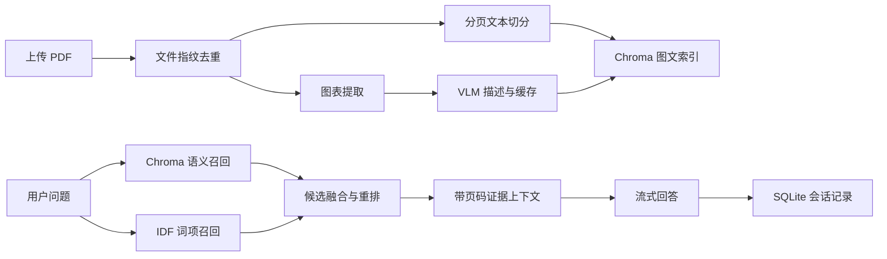

# PaperTrace 论文证据问答助手

PaperTrace 是一个面向研究生和实验室的本地论文库工具。它解决三个具体问题：多篇论文难以快速定位原文、图表信息无法被普通文本检索覆盖，以及大模型回答缺少可核对的页码证据。

系统接收一组 PDF，提取带页码的文本和图表，建立图文混合索引，并在回答中返回论文名、页码、原文片段和相关图表。它适合用于文献调研、方法对比和实验结果核对，不用于替代论文原文。

## 已实现功能

- **增量索引**：使用 SHA-256 文件指纹识别未变化的论文，重复执行索引不会重复写入向量库。
- **后台任务**：上传或扫描目录后立即返回任务 ID，可查询解析、图表描述和入库进度；单篇失败不会中断整批任务。
- **图文混合检索**：PyMuPDF 提取分页文本与嵌入图片，通义千问 VLM 将图表转换为可检索描述，FastEmbed 与 Chroma 保存统一索引。
- **混合检索**：融合 Chroma 语义召回与 IDF 词项召回，兼顾自然语言语义、模型名、指标数值和缩写等精确信息。
- **证据回答**：回答中的 `[1]`、`[2]` 对应论文、页码、片段和图表，证据不足时要求模型明确说明。
- **多轮会话**：SQLite 保存最近对话，后续问题可以利用同一会话的上下文。
- **流式输出**：SSE 持续返回模型生成内容，网页可以边生成边展示。
- **并发、缓存与重试**：过滤 PDF 内重复图片，图表描述默认 4 路并发，并按图片哈希和模型名称缓存；远程模型调用采用指数退避重试，文本索引可在 VLM 失败时继续使用。
- **离线证据模式**：没有 API Key 时仍可完成文本检索并返回相关证据摘要，便于本地开发和测试。
- **可复现评测**：评测脚本统计来源命中率、页码命中率、答案关键词覆盖率和 P50/P95 响应时间。
- **调用链路可观测性**：SQLite 持久化索引与问答 trace，记录检索/生成耗时、引用数、Token 用量、错误和索引阶段耗时；网页展示最近调用的成功率与延迟分位数。

## 处理流程



## 快速启动

### 1. 创建环境

```bash
python -m venv .venv
```

Windows PowerShell：

```powershell
.\.venv\Scripts\Activate.ps1
pip install -r requirements-dev.txt
```

### 2. 配置模型

```powershell
Copy-Item .env.example .env
```

在 `.env` 中填写 `DASHSCOPE_API_KEY`。如果暂时不填写，系统会进入证据预览模式，不生成大模型归纳答案和图表描述。

图表较多时可通过 `CAPTION_WORKERS` 调整 VLM 并发数，默认值为 `4`。账号限流较严格时可降为 `2`；不建议盲目调高，否则可能因限流触发重试，反而延长索引时间。`VISION_MAX_TOKENS` 控制单张图表描述的最长输出，默认 `280`。

### 3. 启动

```bash
uvicorn main:app --reload
```

打开 <http://localhost:8000>，选择一篇或多篇 PDF，点击“上传并建立索引”。首次运行会下载嵌入模型。

也可以使用 Docker Compose 一键启动：

```powershell
docker compose up --build
```

也可以把文件放进 `pdfs/`，然后调用：

```bash
python test_api.py index ./pdfs
```

## API

| 方法 | 路径 | 用途 |
| --- | --- | --- |
| `GET` | `/api/health` | 查看模型配置与索引统计 |
| `POST` | `/api/documents/upload` | 上传 PDF 并创建后台索引任务 |
| `POST` | `/api/index` | 索引服务器上的 PDF 目录 |
| `GET` | `/api/jobs/{job_id}` | 查询任务进度和失败原因 |
| `GET` | `/api/documents` | 查看论文库及索引状态 |
| `GET` | `/api/observability/summary` | 查看成功率、延迟、Token 与引用汇总 |
| `GET` | `/api/observability/traces` | 查看最近的索引和问答调用链路 |
| `POST` | `/api/ask` | 返回完整回答和结构化证据 |
| `POST` | `/api/ask/stream` | 通过 SSE 流式返回回答 |
| `GET` | `/api/sessions/{session_id}/messages` | 读取会话记录 |

完整接口结构可在启动后访问 <http://localhost:8000/docs>。

## 项目结构

```text
papertrace/
├── main.py                 # FastAPI、上传、任务与流式接口
├── rag_service.py          # 索引和证据问答编排
├── pdf_parser.py           # PDF 文本切分、图片提取和文件指纹
├── image_caption.py        # VLM 图表描述、缓存和重试
├── vector_db.py            # Chroma 索引、检索和混合重排
├── storage.py              # SQLite 文档、任务、缓存与会话状态
├── static/index.html       # 无构建依赖的演示网页
├── scripts/evaluate.py     # 来源、页码、关键词与延迟评测
├── tests/                  # 不调用外部模型的核心测试
└── docs/design.md          # 设计取舍与已知限制
```

## 当前限制

- 扫描件 PDF 尚未接入整页 OCR；当前 OCR/VLM 主要处理 PDF 中提取出的图片。
- 部分矢量图由 PDF 绘图指令组成，无法通过嵌入图片接口直接提取。
- 后台任务运行在单个 Web 进程中，适合个人或小型实验室部署；多实例部署需要外部任务队列。
- 当前混合检索使用轻量词项覆盖重排，尚未接入专门的 Cross-Encoder reranker。
